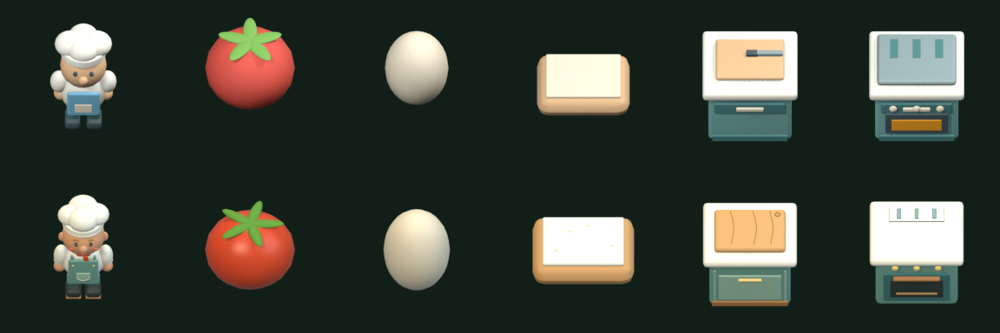

# 汤与吐司的有限视觉样板

本批沿用手作小馆的奶油白、鼠尾草绿、橡木与暖金色。厨师原四方向八帧待机、行走、持物、切配、递餐和无刀作业完整保留；不重制其他章节。

上排为生产图集，下排为样板映射；从左至右为厨师、番茄、鸡蛋、面包、切配台、烤箱。厨师沿用既有Bistro源，本批扩展原料及烤箱。对照由 `review_coherence.py` 读取两份导出清单生成；这张原生渲染对照不是游戏截图。静态导出前恢复原模型第一帧，避免原切配动画的刀具可见性关键帧污染原料图片；无刀作业仅在临时渲染场景移除刀具可见性动画，保存的可编辑源保留原厨师动画。

| 覆盖 | 实际来源与表现 |
| --- | --- |
| 汤链 | 新增番茄、切番茄、鸡蛋和蛋液；沿用碗、锅、八帧汤面。原料与完成汤面分层叠加，空器具不画死食物 |
| 吐司链 | 新增浅色面包；沿用金黄吐司、空盘。加工由实际烘烤进度和蒸汽表示 |
| 设备 | 沿用四向切配台与炉台，新增同材质四向烤箱；设备占地、方向和可操作位置不变 |
| 状态 | 脏污、订单绑定票、份数、加工进度仍取真实投影，使用原独立覆盖层与文字 |
| HUD | 样板物品使用同一 Bistro 切片；其余有效定义使用生产图集。手持与订单共用完整生成范围，未知定义显示问号占位 |

可编辑源为 `source/RestaurantCoherence.blend`，保留原厨师动画、原有物件及新增 `coherence_*` 根节点。原 `source/HandmadeBistro.blend` 保留。脚本 `coherence_models.py` 从既有 `build_bistro.py` 复用软边几何工具，以原材质、相机和三盏灯生成新增物件。

相机为原 45° 正交，相机朝向与地图显示方式不变。每格192×192，16列，图集索引自下而上；本批244帧，3072×3072，清单为同次生成的 `runtime-layout.csv`。角色维持原脚底锚点和逐帧手部挂点；静态物件与设备切片使用中心锚点，设备世界尺度由原格子/Footprint决定。新增静态帧排在无刀作业32帧之后，不能套用角色脚底锚点。

同一次执行 `export_unity.py` 会生成新增模型源、图集、运行清单、布局C#及挂点；禁止单独手改生成布局。比较时查看新 `coherence/` 原料及烤箱与原 `frames/` 碗、锅、吐司、切配台、炉台：统一圆润轮廓、左上暖主光、右侧冷补光、低饱和绿器具；生面包浅色，吐司以烤痕和黄油区分，不只变色。

实际运行基线：独立咖啡厨房1401中拿起热饮杯59，旧HUD手持图标 `enabled=false / sprite=null`；原始图在 `Unity/Assets/Temp/visual-coherence-hand-icon-before.png`。修复后同场景同物品图标正确，运行和资源owner验收已通过。2026-10-20用户明确回复“接受这个有限样板方向”；详细证据见 `openspec/changes/archive/2026-10-20-restaurant-visual-coherence-pass/execution-notes.md`，本次没有扩产其他章节。
