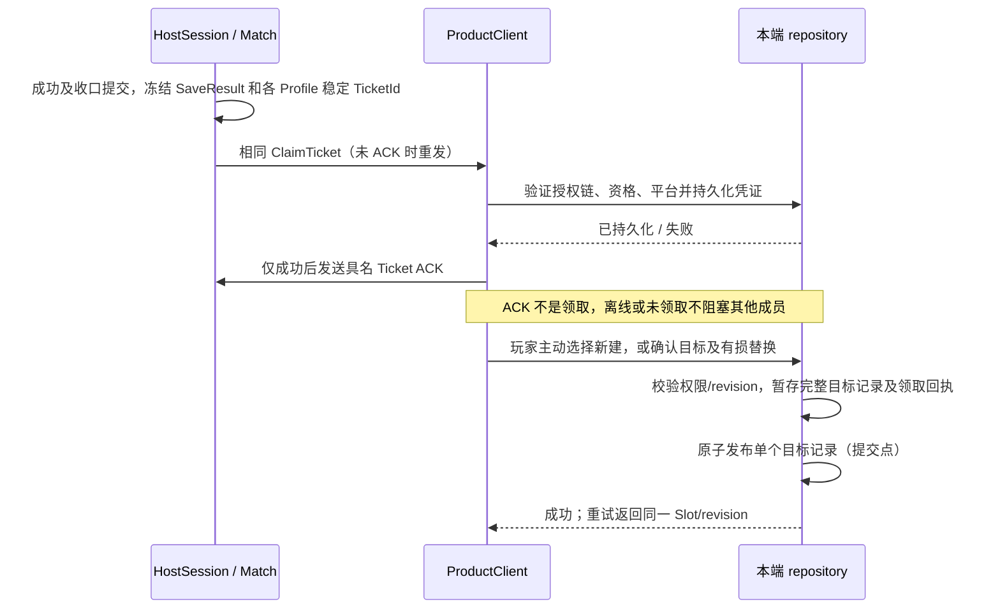
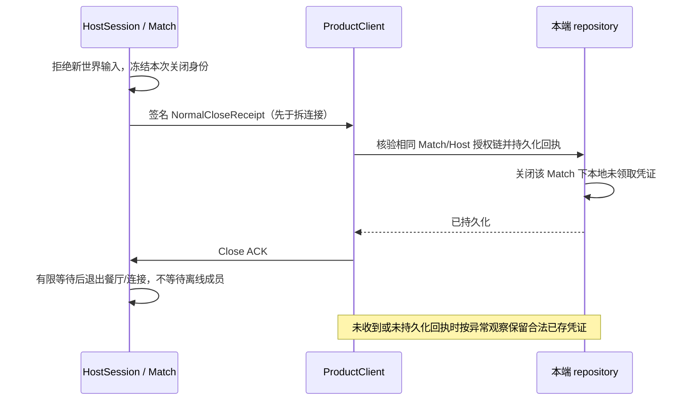

# 离线合作进度协议（首版）

状态：2026-10-15 用户明确接受“离线文件授权，按上述限制实现”。本文确定产品边界及实施交接；运行交付仍以相关 change 的验收记录为准。

## 已确认范围

同平台玩家主动交换可验证的授权文件；合法导入立即形成接收 Profile 的独立分支。没有账号中心、云存档或撤销服务器。原 Owner 不能远程撤回已经导入的分支；凭证副本在另一设备独立处理，不保证跨设备全局只领取一次。PC 与 Android 的授权、Profile、存档、结果和凭证互不通用。

Host 只裁决当前世界，不因此获得任何文件的写权限。正常关闭按各端实际收到并持久化的回执判断；没有收到者不能被推断为已撤销资格。首版保护应用可观察的文件写入失败及重试，不承诺任意断电、文件系统损坏或用户手工修改文件后的事务保证。

## 身份、密钥和证明

每个本地 Profile 使用独立随机 ProfileId、KeyId 及本地签名密钥。实施优先使用现有运行时的 RSA-2048/PKCS#1 签名 API，无额外服务或密码学依赖。私钥只保留在本端 Profile 私有目录，不进入基线、网络快照或授权文件；丢失私钥不能仅凭同名或 ProfileId 接管旧身份。首版不提供中心找回或自动跨设备同步私钥。

公钥身份文件包含格式版本、Platform、ProfileId、KeyId、公钥和显示名。显示名不用于授权。首次主动导入时展示签发者及来源，建立本端 ProfileId/KeyId→公钥的绑定；已绑定身份出现不同公钥须拒绝，不静默替换。离线信任来自玩家主动交换和确认的文件，不把自签名当中心实名认证。

加入合作的长期 Profile 资格须证明私钥持有：Host 产生本次 Match/Peer/绑定代次的一次性随机挑战；Client 签名后由可信 Peer 转交 HostSession 核验。证明包括 Platform、ProfileId、KeyId、公钥、MatchId、挑战和绑定代次，不能复用旧连接证明。Participant 保存已验证 Profile 身份；ResumeCredential 只恢复当前成员绑定，不能替代长期证明或更换该成员的 Profile。

## 签名载荷和授权范围

签名覆盖固定版本的完整规范载荷，包含用途和平台；解析先检查版本、大小、必填字段及允许用途，再验证签名。未知版本、用途混用、签名不符、身份公钥冲突、平台不符均拒绝，不能退化为明文自报授权。签名是业务授权检查，不生成额外文件 hash 清单或测试证据包。

| 载荷 | 签发者与必需身份 | 可授予的行为 |
| --- | --- | --- |
| ReadRunGrant | Save Owner；GrantId、直接来源 Profile/Slot/revision、根来源、完整基线及接收Host公钥/Match绑定 | 只读运行与本轮结果委托；不能用于导入或覆盖 |
| ImportBranchGrant | Save Owner；GrantId、完整源记录、直接/根谱系及有效期 | 接收者主动导入独立分支；不授予源档写权 |
| ReplaceGrant | 目标 Save Owner；GrantId、目标 Profile/Slot、预期 revision、允许的来源根及领取 Profile | 仅授权指定目标的显式有损替换，不可扩大至其他档 |
| MatchAuthority | 已验证基线授权与本次 Host Profile/MatchId | 将本轮世界的共同结果签发权交给该 Host；不授予文件覆盖权 |
| ClaimTicket | 受委托的本次 Host；SaveResultId、MatchId、基线来源/版本、完整成功结果、合资格 ProfileId | 本端主动领取指定成功结果；不是直接写档命令 |
| NormalCloseReceipt | 同一次 Match 的已验证 Host | 关闭该 Match 下本端未领取资格；不能撤回已成功领取记录 |

ReadRun 只允许以授权基线创建运行副本，保持其 Save Owner 身份；ImportBranch 创建新 SlotId、以接收 Profile 为 Owner，保存直接和根谱系及 GrantId。不能把“加载运行”偷偷当作导入或覆盖。Owner 可停止继续签发，也可在本设备拒绝尚未使用的授权；离线副本及已导入分支不受远程撤销保证。

新开餐厅的运行发起者签发本轮 MatchAuthority；从非 Host Owner 基线开局则需其有效授权链。结果验证必须连同该链核对，不能只因当前 Session 来自 Host 就接受任意文件权限。

### 首次读取的具体载荷

合作基线首版把Owner签名的ReadRun和本次MatchAuthority放在一个完整授权封套中：明确接收Host的ProfileId/KeyId、本次MatchId、GrantId、完整源记录及本次结果签发委托。界面签发动作明示“只读运行与本轮结果授权”；该封套仍不授予ImportBranch或覆盖权。目标Host公钥须先经主动文件导入建立绑定；加载时还要与Host本地已证明的Profile匹配，不因Session或自报编号放行。

旧Solo v1–v4未携带可验证的跨Owner根授权，第一次签发时以当前合法源记录的Owner/Slot/revision作为可验证根锚；旧SourceSlot等值只读保留，不补造过去的跨Owner授权。后续新格式及导入分支须延续已建立的直接与根谱系，不能任意改根。原始旧文件不因此改写。

## 结果、送达与领取

Level 开始提交时冻结已证明的 Participant/Profile 资格；迟加入者只参与后续关卡的资格冻结。同一 Profile 重复连接不能产生第二份本关资格。提交前退出、崩溃或失败现场不产生成功结果。

每张凭证包含稳定 TicketId，消费键为 SaveResultId+EligibleProfileId。本端最多成功一次；重发或结果丢失重查必须返回原结果。领取成功事实随目标记录在同一次发布中落盘；额外的凭证消费标记可以补写，不能形成“档已写入而重试再建一档”的窗口。后续检查点或替换保留本端已领取事实，不因覆盖载荷而重新开放旧资格。

新建 Slot 归领取者；替换保留目标 Owner、检查目标 Slot/revision/授权根/接收 Profile，UI 展示 Owner、目标和有损含义，再由本次明确动作确认。只有谱系关系或 Host 身份不足以替换。

## 正常关闭和异常观察

回执只用于整个 Match 的显式正常结束；仅关闭餐厅返回原房间不发送，也不关闭该 Match 的持久资格。签名 Host 还须与本端当前连接确认的 Host 身份一致；另一已信任玩家不能代签该房间的关闭。

回执重复处理幂等；先收到回执后迟到的同 Match 凭证不能重新开放资格。伪造、旧 Match 或不同 Host 的回执不改变资格。已领取记录不因关闭而删除。Dispose 不临时制造成功结果、授权、领取或关闭回执。

## 文件提交与错误

使用现有 repository 的本地有序入口，在目标同目录暂存完整记录并关闭写入，再用文件系统的原子创建/替换发布。发布前失败清理本次临时文件，旧有效记录不变、凭证仍可重试；临时文件不进入选档。发布后的成功回执与目标记录一致，重复请求通过已落盘事实返回原消费回执的Owner/Slot/revision元数据；若目标后来被替换，不伪造或恢复当时的旧载荷。成功替换后不保留供用户恢复的上一版本或备份。

| 错误 | 后果 |
| --- | --- |
| UnsupportedVersion / WrongPlatform / InvalidSignature / ProfileKeyConflict | 拒绝载荷，不创建世界、不写档、不消耗资格 |
| GrantScopeDenied / WrongOwner / IneligibleProfile / ClaimClosed | 拒绝相应行为，不因当前联网身份降级放行 |
| RevisionConflict / TargetChanged | 保留目标及凭证，刷新目标后重新确认 |
| StorageFailure / CapacityExceeded | 发布前保旧、可重试；发布后重查已提交结果 |
| AlreadyClaimed | 返回本端原 Slot/revision，不再次写入 |

任意断电、磁盘物理损坏、外部删除或篡改本地私钥/存档不在首版保证内。若实际测试发现发布非原子或崩溃造成重复领取，必须收紧提交实现并补对应文件 UTF；不能用免责声明接受已知可重现的数据丢失。

授权回执从v6加入；当前PC内容格式为v7，v1–v6只读适配且不改原文件。v6及后续回执带用途、消费Profile、目标Owner/Slot/revision、结果或Grant身份，与目标记录同次发布。导入不继承外部设备的消费台账；后续本端记录与覆盖保留已有本端事实。本端拒绝只作用于未使用许可，已经导入的分支不受影响。

## owner 和交接

ProductRoot 的 repository 拥有本端文件及长期身份；Host Match 拥有已验证成员、当前授权基线和运行结果，Level 拥有开局资格冻结；Client 只持独立值及本端持久化请求。运行结果随 Match 释放，合法离线凭证不依赖旧 ET Entity/Session。

本地 UI→ProductClient→既有 ProcessInnerSender/有序 MailBox→repository 或可信 Peer→HostSession；远端经原 Session/ProductWire 白名单进入同一 Peer/HostSession 裁决。请求每跳按原调用回收，跨 await 保留独立值和 EntityRef/InstanceId，答复检查 Match/World/Level/绑定代次。状态提交后才发布观察事件。

实施交接：[协议 change](../../openspec/changes/archive/2026-10-15-progress-authorization-contracts/design.md)、[基线](../../openspec/changes/archive/2026-10-15-cooperative-save-baseline/design.md)、[结果领取](../../openspec/changes/archive/2026-10-15-cooperative-result-claims/design.md)、[导入替换](../../openspec/changes/archive/2026-10-15-save-branch-import-and-replace/design.md)。旧 Solo v1–v4 继续只读适配；文件格式和 wire 版本在各实施案按届时真实版本演进。
